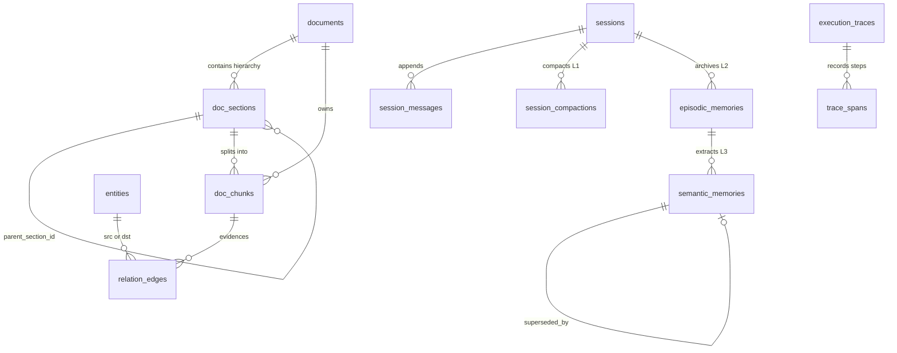
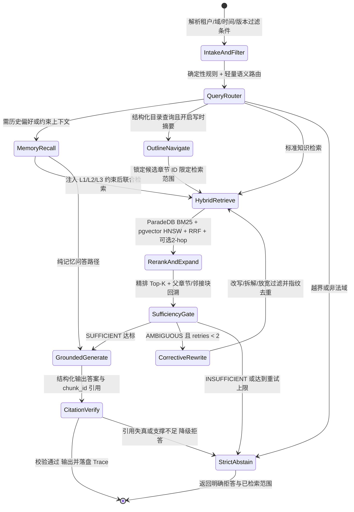
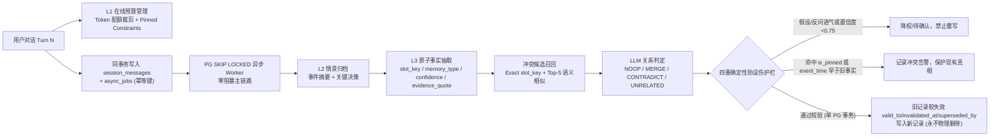

# TerraceMem 架构设计文档

本文档记录 TerraceMem 的核心设计原则、技术选型权衡、PostgreSQL 统一数据模型、Agentic RAG 显式状态机、三层双时态记忆防误伤机制以及内置 Inspector 形态规范。

---

## 1. 核心工程原则

1. **确定性边界管住概率推理**：存储事务、租户/版本/时间过滤、多跳防环、执行预算熔断、引用白名单校验与记忆软失效审计全部用确定性代码和 SQL 保障；LLM 只负责语义路由、改写、提炼、灰区门控与受约束生成。
2. **统一关系库底座（Single Source of Truth）**：以单一 PostgreSQL 同时承载文档树、向量检索、真 BM25、轻量关系边、三层双时态记忆、异步 Outbox 任务与执行 Trace，彻底消除多库双写漂移与 Redis/Neo4j/Qdrant 运维割裂。
3. **轻框架与高可观测性**：不引入 LangChain / LangGraph 等重框架；采用自研 Typed Async FSM + Pydantic v2 结构化校验，每一步节点输入输出自动落盘至 `execution_traces` / `trace_spans`。
4. **复用基础设施，自研核心引擎**：直接复用 PostgreSQL 扩展（`pgvector 0.8`、`ParadeDB pg_search`）、Docling 文档解析与官方 `mcp` SDK；把精力集中在混合检索编排、CRAG 门控、双时态冲突防误伤与离线消融评测上。

---

## 2. 技术选型与深度权衡

### 2.1 PostgreSQL 向量 + 中英文 BM25 混合检索

| 维度 | 选定方案 | 关键原理与权衡 |
| :--- | :--- | :--- |
| **向量检索** | **`pgvector 0.8+` (`halfvec(1024)` + HNSW)** | FP16 `halfvec` 减少 50% 索引内存占用；查询时启用 `SET LOCAL hnsw.iterative_scan = 'relaxed_order'`，彻底解决传统 HNSW 在多租户 `WHERE` 过滤下的 Post-filtering 召回饥饿问题。 |
| **默认 BM25 后端** | **ParadeDB `pg_search`**（单镜像 `paradedb/paradedb:latest`） | 底层为 Rust Tantivy，内置 `jieba` 中文分词；支持 **Fast Fields 列式下推过滤**，`tenant_id`/`namespace`/`is_active` 直接在倒排索引扫描阶段位图剪枝，避免全局 WAND Top-K 候选耗尽（相较 `vchord_bm25` 的全局 `bm25_limit` 在多租户强过滤下更稳定）。 |
| **零扩展降级后端** | **Native PG `tsvector` + Python `jieba` 预分词** | 通过 `LexicalBackend` 协议一键切换（`TERRACEMEM_LEXICAL_BACKEND=native`），确保无 ParadeDB 环境的标准托管 PG（RDS / Neon / Supabase）或本地测试环境均可运行。 |
| **轻量多跳图** | `entities` + `relation_edges` + **`WITH RECURSIVE` 2-hop CTE** | 满足 1–2 跳实体/文档关联召回，路径数组确定性防环、`depth < 2` 硬限制，省去独立 Neo4j 图库。 |

### 2.2 文档解析与可选「写时精炼增强」

- **双轨解析**：
  - Markdown / 代码 / 纯文本走内置原生标题树解析器（零重依赖、毫秒级、保护代码块与表格）；
  - PDF / DOCX / PPTX / HTML 通过可选依赖集成 **IBM Docling (MIT)** 及其 `HybridChunker`，自动保留章节层级与表格表头上下文。
- **双层上下文增强**：
  1. **确定性面包屑（必开，零 LLM 成本）**：`contextual_text` 注入 `[Doc > H1 > H2]` 结构头，`raw_text` 保持纯净供引用核对；
  2. **可选写时精炼（`enable_write_time_enrichment` 开关）**：入库时用小模型提炼文档/章节摘要（`summary`）与规范化同义关键词（`keywords`），既支撑 MCP `kb_browse_outline` 目录树导航，又通过生成列 `lexical_text` 并入 BM25 索引增强确定性字面匹配。原文与向量路始终保留，避免有损摘要遗漏长尾细节。

### 2.3 Python 服务端、MCP 与零 Redis 异步队列

- **Web & MCP 统一进程**：FastAPI 托管 `/api/v1/*`（REST + SSE）、挂载官方 `mcp` v2 (`MCPServer`) Streamable HTTP 于 `/mcp`、并在 `/ui` 托管零构建单页 Inspector；同时提供 `terracemem mcp --stdio` 供 Claude Code / Codex 本地挂载。
- **DB 访问**：`psycopg 3` (`psycopg[binary,pool]` async) + Alembic 迁移；核心混合检索与 2-hop CTE 使用强类型参数化原生 SQL。
- **LLM & 编排**：`AsyncOpenAI`（API-first，兼容 OpenAI / DeepSeek / Qwen / OpenRouter / 本地 Ollama & TEI）+ Pydantic v2 结构化校验 + 自研 Typed Async FSM。
- **零 Redis 异步任务**：PG `async_jobs` 表 + `SELECT ... FOR UPDATE SKIP LOCKED` + `LISTEN/NOTIFY` Outbox Worker，业务写入与后台记忆抽取共享同一个 ACID 事务，通过 `idempotency_key` 保证幂等。

---

## 3. PostgreSQL 统一数据模型

所有核心表均在 [0001_initial_schema.py](../alembic/versions/0001_initial_schema.py) 中维护，主键统一使用 **UUIDv7**（时间有序、减少 B-tree 索引页分裂）。

### 3.1 四组核心表职责

1. **文档树与检索表（`documents` / `doc_sections` / `doc_chunks`）**：
   - 支持 `(tenant_id, namespace, external_key, version)` 版本控制与 `content_hash` 幂等重入库；
   - `doc_chunks` 使用存储生成列 `lexical_text` 融合 `contextual_text` 与 `enriched_keywords`，同一张表承载 `halfvec(1024)` HNSW 索引与 ParadeDB BM25（或 GIN `search_tokens`）索引。
2. **轻量关系图（`entities` / `relation_edges`）**：
   - 唯一规范实体键 `(tenant_id, namespace, entity_type, lower(canonical_name))`；
   - 每条关系边携带 `evidence_chunk_id` 证据溯源与有效期字段，递归 CTE 遍历硬限 2 跳并防环。
3. **三层双时态记忆（`sessions` / `session_messages` / `session_compactions` / `episodic_memories` / `semantic_memories`）**：
   - **双时态设计**：分离 **有效时间轴（`valid_from` / `valid_to`）** 与 **事务时间轴（`recorded_at` / `invalidated_at` / `superseded_by`）**；
   - 默认检索 `valid_to IS NULL AND invalidated_at IS NULL` 获取最新真相；审计模式可传入 `as_of` 时间点回放历史认知。
4. **异步任务与 Trace（`async_jobs` / `execution_traces` / `trace_spans`）**：
   - 记录每次调用的路由、各路检索命中 ID、精排得分、门控重试次数、拒答原因、延迟与 Token 成本。

---

## 4. 核心工作流与确定性安全边界

### 4.1 Agentic RAG 显式状态机

- **硬预算熔断（`ExecutionBudget`）**：`max_retrieval_retries = 2`、`max_state_transitions = 10`、`max_llm_calls = 5`、`request_timeout_seconds = 30`、`seen_query_fingerprints` 防死循环。
- **两级 CRAG 门控**：低底线直拒、高置信直通（零额外 LLM 成本），仅灰区调小模型判定缺失维度并决定改写或拒答。
- **确定性引用校验（`CitationVerifier`）**：白名单核查所有引用 ID 属于本次真实检索证据且有效，杜绝伪造引用。

### 4.2 三层记忆异步闭环与四重防误伤护栏

四重确定性防误伤护栏（实现于 `src/terracemem/memory/guardrails.py`）：
1. **置信度与断言语气门槛**：`confidence < 0.75` 或非 `asserted`（如假设/询问/转述）禁止触发 `CONTRADICT`；
2. **证据必填约束**：`CONTRADICT` 必须附带非空 `contradiction_reason` 与原文 `evidence_quote`；
3. **时间先后守卫**：新事件 `event_time` 早于现有有效事实 `valid_from` 时，禁止旧历史补录反杀最新真相；
4. **Pinned 硬约束保护**：`is_pinned = true` 的核心记忆禁止被后台隐式抽取静默覆写，仅标记待人工/显式确认。

---

## 5. 产品形态：Headless 引擎 + 内置轻量 Inspector

TerraceMem 定位为 **Agent 基础设施引擎**，不做成重型聊天套壳 App，而是采用 **Headless Server / MCP / CLI + `/ui` 内置开发者调试台**（对标 Qdrant Web UI / Jaeger / Temporal Web）：

- **RAG Playground & Trace 透视镜**：实时查看路由、各路召回、RRF/Rerank 排名变化、CRAG 门控重试/拒答与引用核验；
- **文档树与写时精炼视图**：查看文档版本、章节树摘要/关键词及分块明细；
- **双时态记忆时间线**：展示 L1/L2/L3 记忆与 `superseded_by` 演化链，支持 `as_of` 时间滑块回放；
- **评测消融看板**：加载 `evals/reports/*.json` 渲染 RAG 与 Memory 对比指标图表。
